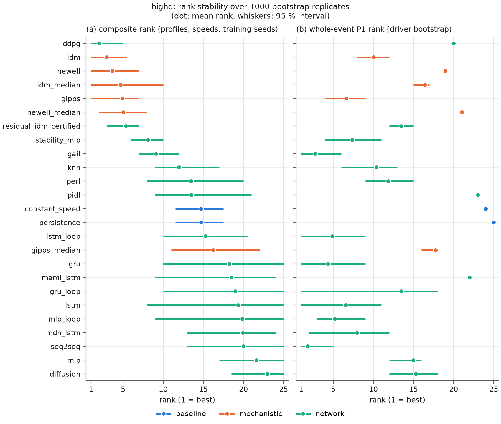

# TrafficLoop leaderboard: highd

Generated by `scripts/make_leaderboard.py` from `results/models` on 2026-11-17; definitions in `docs/leaderboard.md`, the checklist in `docs/checklist.md`. 3 decimals, `n/a` = not available.

Ranked entries (driver split, fold 0, seed 0): **25 admitted, 0 refused**; no run under the `event` split; run directories validated: 200, refused 0.

## Main table

Sorted by the composite (lower is better), then by the whole-event P1 spacing error. `[low, high]`: 95 % intervals over 1000 replicates (seed 0): driver bootstrap with common random numbers across models for P0 and P1 (per-event tables that reproduce their JSON summary), bootstrap over the in-range P2 profiles, the P3 speeds with an equilibrium and the training seeds for the composite rank (the rank of the seed-0 composite, average ranks on ties). P0 ratio: RMSE_a(model) / RMSE_a(persistence). `*`: in-range values (P2 over the OpenACC profiles inside the 1-99 % speed range of the training data and the pulse, P4 over the synthetic scenarios inside it). P3: numerical unstable fraction at 0.05 m/s (at 1 m/s in parentheses) over the speeds with an equilibrium (n/a: none). Seed spread: min-max over the training seeds. Fold spread: min-max over the folds of the driver split, each against persistence on the same fold (the clean arms of the paired split where an entry has no run on folds 1-4).

Entries by the authors of the benchmark (marked †): `residual_idm_certified`: the authors' own method (Gorodnichev and Moseva, Mathematics 2026, 14(22), 4152), added on 2026-10-15 after the other entries had been scored; its amplitude and the rule that chooses its core were fixed after two pilot configurations on NGSIM, from the admissible certificate budgets and not from a score, although the pilot scores had been seen (docs/decisions.md, M2-8 and REV1-4); its unstable fraction is zero by construction; `stability_mlp`: the authors' own variant (an MLP with a string-stability penalty), part of the original set of entries.

| model | family | P0 ratio [95% CI] | P1 10 s RMSE_s (m) [95% CI] | P1 30 s RMSE_s (m) [95% CI] | P1 whole RMSE_s (m) [95% CI] | P1 whole collision rate | P2 concave-growth error\* | P2 hysteresis error\* | P2 collisions_100\* | P3 unstable fraction (1 m/s) | P4 collision rate synthetic\* / empirical | composite | composite rank [95% CI] | composite v2 | rank v2 | P0 ratio seed spread | P1 whole seed spread (m) | P0 ratio fold spread | P1 whole fold spread (m) |
|---|---|---|---|---|---|---|---|---|---|---|---|---|---|---|---|---|---|---|---|
| ddpg | network | 109.255 [104.935, 113.396] | 10.237 [9.871, 10.576] | 10.083 [8.885, 11.350] | 11.904 [11.376, 12.474] | 0.000 | 0.545 | 224.800 | 0 | 0.400 (0.550) | 0.000 / 0.150 | 0.078 | 1 [1.0, 5.0] | 0.184 | 1 | [109.255, 115.810] | [11.885, 12.049] | [108.350, 117.864] | [11.865, 12.666] |
| gipps | mechanistic | 191.963 [184.977, 198.634] | 3.788 [3.632, 3.949] | 6.470 [5.416, 7.473] | 6.153 [5.555, 6.846] | 0.000 | 0.557 | 243.846 | 0 | 0.933 (0.733) | 0.000 / 0.041 | 0.161 | 2.5 [1.0, 7.0] | 0.219 | 3 | [190.133, 198.026] | [6.087, 6.153] | [191.963, 205.595] | [5.831, 6.598] |
| idm | mechanistic | 72.787 [68.996, 76.894] | 3.731 [3.612, 3.849] | 7.618 [6.591, 8.771] | 6.665 [6.083, 7.387] | 0.000 | 0.572 | 250.123 | 0 | 0.192 (0.269) | 0.000 / 0.021 | 0.161 | 2.5 [1.0, 5.5] | 0.198 | 2 | [72.787, 84.570] | [6.633, 6.718] | [72.787, 80.262] | [6.583, 7.255] |
| idm_median | mechanistic | 34.721 [32.512, 37.277] | 5.865 [5.692, 6.044] | 9.496 [8.499, 10.535] | 9.234 [8.701, 9.852] | 0.000 | 0.550 | 223.535 | 13 | 0.962 (0.962) | 0.000 / 0.028 | 0.167 | 4 [1.0, 10.0] | 0.278 | 5 | [29.934, 34.721] | [9.151, 9.383] | [31.640, 36.736] | [9.100, 10.082] |
| newell_median | mechanistic | 251.299 [241.690, 260.295] | 11.480 [11.043, 11.949] | 11.041 [9.615, 12.686] | 13.078 [12.546, 13.683] | 0.011 | 0.608 | 234.478 | 321 | 0.000 (0.947) | 0.000 / 0.294 | 0.198 | 5 [2.0, 8.0] | 0.410 | 9 | [249.409, 253.836] | [12.923, 13.374] | [251.299, 267.127] | [13.078, 14.792] |
| residual_idm_certified† | hybrid | 122.919 [117.313, 128.716] | 5.318 [5.090, 5.550] | 8.399 [7.225, 9.637] | 7.891 [7.293, 8.606] | 0.000 | 0.659 | 275.183 | 0 | 0.000 (0.000) | 0.000 / 0.046 | 0.214 | 6 [3.0, 7.0] | 0.260 | 4 | [122.919, 125.718] | [7.868, 7.891] | [122.919, 137.018] | [7.618, 8.570] |
| newell | mechanistic | 247.859 [238.702, 256.126] | 9.760 [9.358, 10.247] | 9.784 [8.505, 11.302] | 11.370 [10.829, 12.030] | 0.003 | 0.558 | 244.787 | 334 | 0.000 (0.947) | 0.000 / 0.178 | 0.219 | 7 [1.0, 7.0] | 0.403 | 8 | [245.645, 257.657] | [11.337, 11.452] | [247.859, 262.198] | [11.370, 12.327] |
| stability_mlp† | network | 14.341 [13.956, 14.711] | 3.205 [3.078, 3.330] | 6.746 [5.996, 7.565] | 6.239 [5.860, 6.632] | 0.017 | 0.782 | 240.958 | 564 | 0.733 (0.733) | 0.300 / 0.099 | 0.365 | 8 [6.0, 10.0] | 0.396 | 7 | [14.319, 14.341] | [6.239, 6.445] | [14.236, 14.438] | [6.239, 6.933] |
| gail | network | 13.816 [13.325, 14.318] | 3.108 [2.989, 3.230] | 5.647 [5.120, 6.184] | 5.566 [5.320, 5.834] | 0.003 | 0.612 | 198.625 | 1000 | 1.000 (1.000) | 0.300 / 0.057 | 0.396 | 9 [7.0, 12.0] | 0.292 | 6 | [13.816, 15.382] | [5.566, 5.967] | [13.816, 15.259] | [5.070, 5.850] |
| perl | hybrid | 4.369 [4.093, 4.655] | 2.774 [2.667, 2.885] | 7.763 [6.221, 9.596] | 7.269 [5.936, 9.294] | 0.000 | 0.825 | 1062.153 | 253 | 0.941 (0.765) | 0.000 / 0.021 | 0.458 | 10 [8.0, 20.0] | 0.444 | 10 | [4.369, 4.851] | [5.714, 7.269] | [3.922, 4.369] | [6.250, 7.390] |
| knn | network | 14.759 [14.372, 15.136] | 3.289 [3.157, 3.415] | 7.356 [6.624, 8.089] | 6.745 [6.317, 7.220] | 0.021 | 0.890 | 258.755 | 319 | 1.000 (1.000) | 0.600 / 0.109 | 0.500 | 11 [9.0, 17.0] | 0.562 | 14.5 | [14.735, 14.786] | [6.557, 6.745] | [14.686, 14.902] | [6.745, 7.545] |
| gru_loop | network | 5.473 [5.320, 5.611] | 2.566 [2.458, 2.680] | 6.463 [4.780, 8.284] | 8.272 [5.033, 11.344] | 0.004 | 1.112 | 1755.838 | 469 | 0.833 (1.000) | 0.100 / 0.233 | 0.552 | 12 [10.0, 25.0] | 0.500 | 11 | [5.473, 5.667] | [5.322, 8.272] | [5.339, 5.645] | [5.179, 8.272] |
| constant_speed | baseline | 17.570 [17.180, 17.935] | 7.361 [7.002, 7.702] | 52.982 [47.818, 58.334] | 52.677 [45.794, 59.547] | 0.186 | 2.224 | 256.181 | 13 | n/a | 0.600 / 0.335 | 0.609 | 13.5 [11.5, 17.5] | 0.576 | 16 | [17.570, 17.570] | [52.677, 52.677] | [17.542, 17.991] | [52.677, 61.733] |
| persistence | baseline | 1.000 [1.000, 1.000] | 6.817 [6.495, 7.111] | 75.729 [66.942, 85.663] | 62.688 [55.967, 69.496] | 0.136 | 2.224 | 256.181 | 13 | n/a | 0.600 / 0.319 | 0.609 | 13.5 [11.5, 17.5] | 0.583 | 17 | [1.000, 1.000] | [62.688, 62.688] | [1.000, 1.000] | [62.688, 86.797] |
| mlp_loop | network | 3.082 [3.015, 3.151] | 2.582 [2.464, 2.705] | 7.208 [6.272, 8.095] | 5.926 [5.469, 6.370] | 0.011 | 0.662 | 670.590 | 1392 | 1.000 (1.000) | 0.300 / 0.111 | 0.615 | 16 [9.0, 25.0] | 0.535 | 13 | [2.967, 3.082] | [5.726, 6.059] | [3.037, 3.117] | [5.688, 6.168] |
| gipps_median | mechanistic | 144.278 [139.008, 148.843] | 5.975 [5.760, 6.194] | 10.572 [9.321, 11.840] | 9.890 [9.310, 10.611] | 0.003 | 1.052 | 482.167 | 824 | 1.000 (1.000) | 0.100 / 0.085 | 0.615 | 16 [11.0, 22.0] | 0.597 | 18 | [144.278, 149.243] | [9.637, 10.231] | [144.278, 154.598] | [9.177, 10.895] |
| maml_lstm | network | 13.088 [12.541, 13.676] | 3.149 [2.976, 3.331] | 20.080 [14.693, 24.750] | 16.367 [13.246, 19.425] | 0.024 | 0.703 | 706.985 | 1228 | 1.000 (1.000) | 0.600 / 0.170 | 0.615 | 16 [9.0, 24.0] | 0.646 | 20 | [13.088, 13.140] | [16.090, 18.143] | [12.524, 13.088] | [10.761, 18.305] |
| seq2seq | network | 5.621 [5.495, 5.753] | 2.474 [2.360, 2.592] | 6.763 [5.911, 7.668] | 5.490 [5.058, 5.910] | 0.008 | 0.829 | 434.059 | 422 | n/a | 0.000 / 0.126 | 0.620 | 18 [13.0, 25.0] | 0.510 | 12 | [5.621, 5.698] | [5.450, 6.395] | [5.490, 5.621] | [5.490, 5.922] |
| lstm_loop | network | 5.832 [5.662, 5.986] | 2.609 [2.492, 2.724] | 6.005 [4.989, 7.128] | 6.058 [5.080, 7.512] | 0.004 | 0.729 | 2562.690 | 1298 | 1.000 (1.000) | 0.000 / 0.150 | 0.677 | 19 [10.0, 20.5] | 0.562 | 14.5 | [5.832, 6.405] | [5.198, 6.058] | [5.591, 5.832] | [5.409, 6.434] |
| pidl | hybrid | 17.354 [16.971, 17.712] | 7.135 [6.787, 7.463] | 49.971 [45.135, 55.038] | 49.799 [43.153, 56.055] | 0.176 | 1.598 | 1261.289 | 55 | n/a | 0.800 / 0.325 | 0.682 | 20 [9.0, 21.0] | 0.774 | 24 | [15.303, 17.354] | [7.574, 49.799] | [15.266, 17.494] | [7.585, 54.799] |
| mlp | network | 2.781 [2.725, 2.837] | 3.268 [3.133, 3.414] | 10.877 [9.428, 12.262] | 8.638 [7.983, 9.194] | 0.036 | 1.279 | 4623.830 | 1124 | 1.000 (1.000) | 0.300 / 0.177 | 0.760 | 21 [17.0, 25.0] | 0.722 | 22 | [2.675, 2.781] | [8.638, 9.381] | [2.734, 2.933] | [7.983, 9.351] |
| mdn_lstm | network | 5.202 [5.050, 5.362] | 2.767 [2.633, 2.905] | 7.039 [5.431, 8.892] | 6.535 [5.239, 8.392] | 0.010 | 1.598 | 5533.403 | 1010 | 1.000 (1.000) | 0.000 / 0.148 | 0.792 | 22 [13.0, 24.0] | 0.632 | 19 | [4.900, 5.202] | [5.923, 7.588] | [4.920, 5.229] | [6.358, 8.533] |
| gru | network | 4.290 [4.211, 4.371] | 2.657 [2.508, 2.835] | 6.677 [5.403, 8.303] | 5.802 [5.263, 6.385] | 0.007 | 1.389 | 4385.105 | 1481 | 1.000 (1.000) | 0.200 / 0.325 | 0.802 | 23.5 [10.0, 25.0] | 0.694 | 21 | [4.290, 4.576] | [5.291, 6.428] | [4.247, 4.358] | [5.529, 7.196] |
| diffusion | network | 3.393 [3.202, 3.605] | 3.225 [2.706, 3.900] | 7.810 [6.389, 9.537] | 8.769 [6.595, 10.977] | 0.027 | 15.099 | 104968.324 | 515 | 1.000 (1.000) | 0.700 / 0.417 | 0.802 | 23.5 [18.5, 25.0] | 0.792 | 25 | [3.183, 3.393] | [8.769, 12.156] | [3.124, 4.672] | [7.781, 14.660] |
| lstm | network | 4.688 [4.595, 4.776] | 2.658 [2.472, 2.924] | 6.278 [5.282, 7.423] | 6.287 [5.121, 7.926] | 0.007 | 1.618 | 4034.393 | 1534 | 1.000 (1.000) | 0.300 / 0.275 | 0.833 | 25 [8.0, 25.0] | 0.729 | 23 | [4.688, 5.034] | [5.333, 6.287] | [4.681, 4.747] | [5.554, 7.338] |

Notes:

* Composite rank interval: 1000 replicates over the in-range P2 profiles, the P3 speeds with an equilibrium and the training seeds (in every replicate each model takes one of its admitted runs with P2/P3 tables at random: seeds 0-2, more than one seed for 25 of 25 models); the composite and its rank are those of seed 0.
* Composite v2 (columns `composite v2`, `rank v2`; the table stays sorted by the composite above): the mean normalised rank of six inputs, the four of the composite (P2 concave-growth and hysteresis errors, P3 unstable fraction, P2 collisions_100) plus two realism inputs, the whole-event P1 spacing RMSE and the relative fundamental-diagram error of P2 (`fd_error_rel`, pooled over the samples of all P2 profiles); equal weights, average ranks on ties, a missing value last, over the same models as the composite; rank 1 = best.

*Rank stability*: composite rank and whole-event P1 rank of every admitted model over 1000 replicates (dot: mean rank, whiskers: 95 % interval).

## Driver leak (event split)

No admitted run under the `event` split.

## Transfer

Relative degradation `rmse_s(A -> B) / rmse_s(B -> B)` of the whole event (A: this dataset, B: the target; 1 = no loss) with 95 % driver-bootstrap intervals over the test drivers of B, and its mean over the targets with a ratio. Only admitted entries; the ratio is left out when the run trained on B is not admitted.

| model | family | -> follownet_highd | -> ngsim | mean |
|---|---|---|---|---|
| ddpg | network | 0.966 [0.958, 0.972] | 1.007 [1.006, 1.009] | 0.986 |
| gipps | mechanistic | 1.047 [1.012, 1.077] | 1.344 [1.284, 1.403] | 1.196 |
| idm | mechanistic | 1.142 [1.104, 1.183] | 1.394 [1.323, 1.468] | 1.268 |
| idm_median | mechanistic | 0.965 [0.963, 0.967] | 1.319 [1.281, 1.357] | 1.142 |
| newell_median | mechanistic | 0.953 [0.949, 0.958] | 1.022 [0.982, 1.064] | 0.988 |
| residual_idm_certified† | hybrid | 1.019 [1.011, 1.027] | 1.057 [1.050, 1.064] | 1.038 |
| newell | mechanistic | 1.014 [1.008, 1.019] | 1.095 [1.064, 1.124] | 1.054 |
| stability_mlp† | network | 1.023 [1.008, 1.038] | 1.268 [1.222, 1.313] | 1.146 |
| gail | network | 0.991 [0.979, 1.002] | 0.934 [0.914, 0.957] | 0.963 |
| perl | hybrid | 0.969 [0.930, 1.006] | 1.058 [0.821, 1.295] | 1.013 |
| knn | network | 0.994 [0.973, 1.016] | 1.463 [1.396, 1.523] | 1.229 |
| gru_loop | network | 1.055 [1.031, 1.078] | 4.748 [3.682, 5.842] | 2.901 |
| constant_speed | baseline | 1.000 [1.000, 1.000] | 1.000 [1.000, 1.000] | 1.000 |
| persistence | baseline | 1.000 [1.000, 1.000] | 1.000 [1.000, 1.000] | 1.000 |
| mlp_loop | network | 0.996 [0.983, 1.007] | 1.423 [1.361, 1.500] | 1.209 |
| gipps_median | mechanistic | 0.956 [0.953, 0.960] | 1.367 [1.337, 1.398] | 1.162 |
| maml_lstm | network | 1.017 [0.984, 1.060] | 0.564 [0.325, 0.864] | 0.790 |
| seq2seq | network | 0.923 [0.897, 0.947] | 0.081 [0.077, 0.085] | 0.502 |
| lstm_loop | network | 1.061 [1.035, 1.087] | 1.269 [1.210, 1.331] | 1.165 |
| pidl | hybrid | 2.156 [2.040, 2.299] | 9.486 [8.736, 10.318] | 5.821 |
| mlp | network | 0.943 [0.934, 0.953] | 1.477 [1.411, 1.551] | 1.210 |
| mdn_lstm | network | 0.942 [0.879, 1.004] | 0.193 [0.133, 0.297] | 0.568 |
| gru | network | 0.997 [0.966, 1.022] | 0.117 [0.083, 1.315] | 0.557 |
| diffusion | network | 1.218 [0.979, 1.406] | 0.077 [0.056, 0.109] | 0.648 |
| lstm | network | 0.990 [0.966, 1.014] | 0.149 [0.076, 1.132] | 0.570 |

## Refused entries

None: every run directory of the dataset has a complete checklist.

## Provenance

* **data version**: reconstructed
* **reconstruction method**: qp-semi-implicit-v1
* **split**: driver, fold 0, training seed 0 (checklist split type: driver)
* **seeds**: checklist: global 0, split 0, train 0; seed spread: training seeds 0-2; fold spread: driver folds 1-4
* **git revision of the runs**: training: 13c335120a55e5fc148a6b102c7d2dfcda454cb0 (23), 31967171f678409c62fe94c1e6f668b0559b3ce3 (2); protocols: 31967171f678409c62fe94c1e6f668b0559b3ce3 (126), 13c335120a55e5fc148a6b102c7d2dfcda454cb0 (20), bff18c8066137b539fe46eb027699b8cfdc12b9c (4)
* **protocol configuration hashes**: p1: e742be505ac0; p1_follownet_highd: 73bf244e536b; p1_ngsim: 9de8b9140df1; p2: 2f433d8a62f2; p3: 3b53e6f91840; p4: 0c38ee36eafd
* **bootstrap**: 1000 replicates, seed 0: drivers for P0 and P1 (common random numbers), in-range P2 profiles, P3 speeds with an equilibrium and training seeds for the composite rank (Generator [0, 1])
* **date**: 2026-11-17
